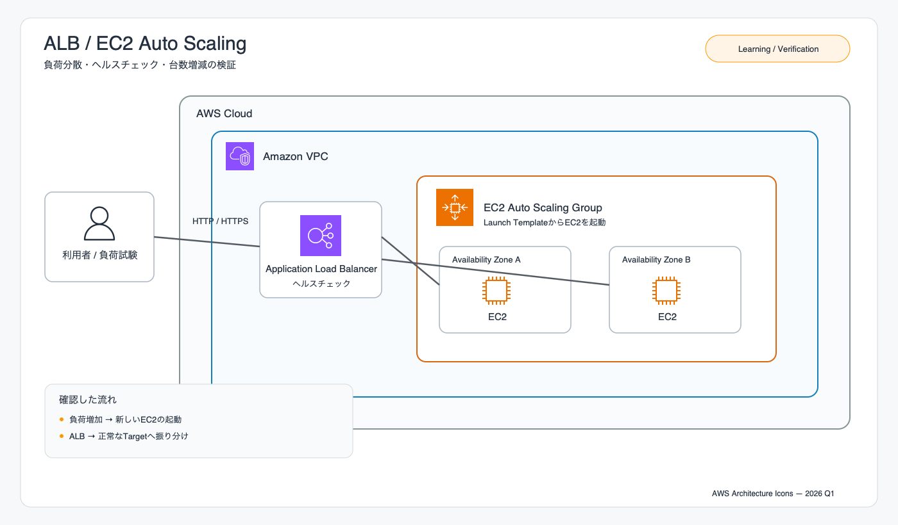

# AWS ALB / Auto Scaling Lab

Application Load BalancerとEC2 Auto Scalingを使用し、アクセスの分散とEC2台数の増減を確認した学習・検証環境です。

負荷を発生させた際にEC2が追加される流れと、ALBのヘルスチェックによって正常なインスタンスへ通信が振り分けられる仕組みを確認しました。

## 構成

構成図には[AWS公式のArchitecture Icons](https://aws.amazon.com/architecture/icons/)を使用しています。

## 使用技術

| 分類 | 使用技術 |
|---|---|
| ロードバランシング | Application Load Balancer、Target Group |
| コンピューティング | Amazon EC2、EC2 Auto Scaling |
| 構成管理 | Launch Template |
| ネットワーク | Amazon VPC、Public Subnet、Security Group |
| 監視 | EC2メトリクス、ヘルスチェック |

## 実施内容

1. EC2の起動設定をLaunch Templateとして作成
2. Auto Scaling Groupの最小・希望・最大台数を設定
3. ALBとTarget Groupを作成
4. ALBのリスナーからTarget Groupへ転送
5. EC2をTarget Groupへ登録
6. ヘルスチェックの正常性を確認
7. EC2へ負荷を発生させ、インスタンスが追加される流れを確認
8. 負荷が下がった後の台数変化を確認

## 確認したポイント

- ALBが正常なEC2へ通信を振り分けること
- ヘルスチェックに失敗したEC2が転送先から外れること
- Launch Templateの内容で新しいEC2が起動すること
- 負荷の増加に応じてAuto Scaling Groupの台数が変化すること
- EC2を直接公開する場合とALBを入口にする場合の違い

## 障害時の確認順序

1. ALBの状態
2. リスナーと転送ルール
3. Target Groupの登録状況
4. ヘルスチェックの状態
5. ALB用・EC2用Security Group
6. EC2上のWebサーバーの稼働状態
7. Auto Scalingのアクティビティ履歴

サービス単体ではなく、ALB、Target Group、Security Group、EC2の順に確認すると原因を切り分けやすいと分かりました。

## 詳しい記録

- [構築・再現手順](docs/build-guide.md)
- [検証内容と確認項目](docs/verification-record.md)

## セキュリティ上の配慮

- EC2側のHTTP通信はALB用Security Groupからのみ許可する構成を想定
- 管理用ポートを不特定多数へ公開しない
- AWSアカウントID、実IPアドレス、秘密鍵は掲載しない

## 注意事項

このリポジトリはAWSの学習・ハンズオン内容を再構成したものです。実際の負荷値やインスタンスIDは保存していないため、確認できた仕組みを中心に記載しています。

